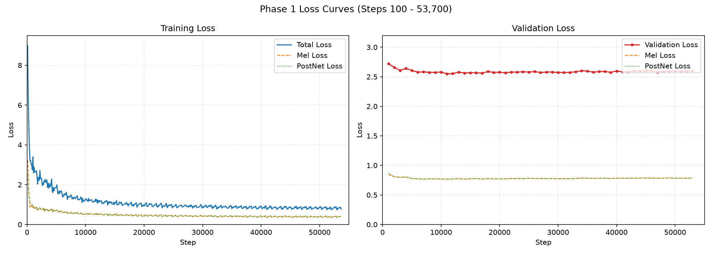
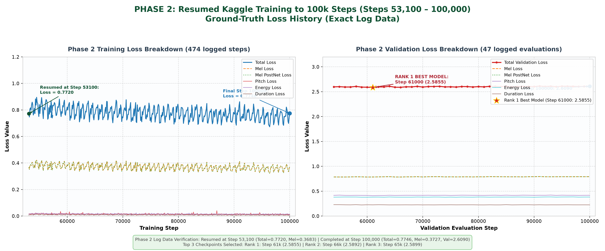
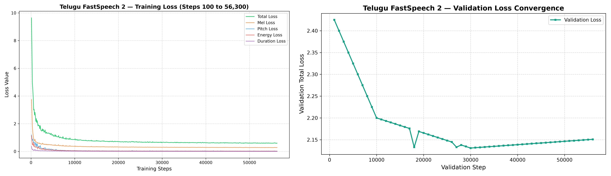
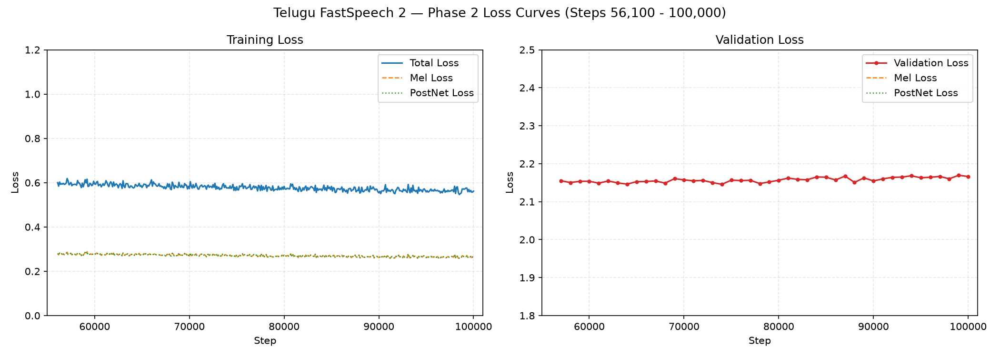

# Multi-Speaker FastSpeech 2: English & Telugu Text-to-Speech

A robust, production-grade non-autoregressive Text-to-Speech (TTS) pipeline implementing **FastSpeech 2** for both **English (Svarah)** and **Telugu (IndicTTS)** with multi-speaker conditioning and HiFi-GAN neural vocoding at **16 kHz**.

---

## 1. Project Overview

FastSpeech 2 synthesizes mel-spectrograms non-autoregressively in parallel from text and phoneme sequences. The pipeline incorporates a **Variance Adaptor** that conditions phonetic representations on duration, continuous pitch ($F_0$), and energy, resolving the one-to-many mapping problem in acoustic modeling.

### Key Highlights
- **Bilingual & Multi-Speaker**:
  - **English (Svarah)**: Multi-speaker architecture conditioned on 104 Indian English speakers.
  - **Telugu (IndicTTS)**: High-fidelity bilingual model trained on male and female native speakers.
- **Phoneme-Level Forced Alignment**:
  - **English**: Montreal Forced Aligner (MFA) v2.2 with ARPAbet/IPA phone mapping.
  - **Telugu**: Meta MMS (Massively Multilingual Speech) CTC alignment with native *akshara* grapheme-to-phoneme conversion.
- **Acoustic Fidelity**:
  - 16,000 Hz audio sampling rate, 80-band mel-filterbank ($F_{\text{min}}=0\text{ Hz}, F_{\text{max}}=8000\text{ Hz}$, FFT size 1024, hop size 256).
  - Continuous pitch extraction via PyWorld with unvoiced frame linear interpolation.
  - Frame-wise L2-norm energy extraction.
- **Memory-Leak-Free Training Infrastructure**:
  - glibc heap trimming (`malloc_trim(0)`) prevents native C-heap fragmentation across 100,000 steps.
  - Dual Tesla T4 multi-GPU DataParallel scaling.
  - Strict checkpoint retention policy (Top 3 validation models + 1 latest checkpoint).
- **HiFi-GAN Universal Neural Vocoder**:
  - 16 kHz multi-period and multi-scale discriminator synthesis yielding artifact-free waveforms.

---

## 2. Repository Structure

```text
TTS/
├── English/
│   ├── train/
│   │   ├── train.py                  # Dual-GPU training engine with memory safeguards
│   │   ├── dataset.py                # PyTorch Dataset & dynamic batch collator
│   │   ├── evaluate.py               # Validation evaluation loop
│   │   ├── prepare_dataset.py        # Dataset verification and staging
│   │   ├── model/                    # FastSpeech 2, Variance Adaptor & Loss
│   │   ├── transformer/              # Multi-Head Attention, Feed-Forward Blocks
│   │   ├── audio/                    # Mel-spectrogram & STFT utilities
│   │   ├── text/                     # G2P, CMUDict, IPA symbols & cleaners
│   │   ├── utils/                    # Checkpoint management, tools, plotting
│   │   └── hifigan/                  # HiFi-GAN vocoder architecture & weights
│   ├── preprocess/
│   │   ├── preprocess.py             # Preprocessing pipeline orchestrator
│   │   ├── stage_and_align_english.py # MFA alignment automation
│   │   ├── extract_acoustic_features.py # Mel, continuous F0, energy extraction
│   │   ├── synchronize_english_manifests.py # Train/Val split synchronization
│   │   └── repartition_and_renormalize_speaker_dependent.py # Speaker stats
│   ├── inference/
│   │   ├── inference.py              # Single-sentence CLI inference
│   │   ├── generate_assignment_audios.py # Official benchmark generator
│   │   ├── generate_heteronym_comparison.py # Noun vs. verb heteronym testing
│   │   ├── compare_checkpoints_diagnostic.py # Checkpoint comparison
│   │   ├── model/, transformer/, audio/, text/, utils/ # Core inference modules
│   │   └── hifigan/                  # HiFi-GAN vocoder
│   ├── checkpoints/
│   │   ├── README.md                 # Checkpoint guide & Drive download links
│   │   └── checkpoints_index.json    # Retention metadata & loss rankings
│   ├── config.yaml                   # Acoustic, model, and training hyperparameters
│   └── English_FastSpeech2_Kaggle.ipynb # Plug-and-play Kaggle training notebook
│
├── Telugu/
│   ├── train/
│   │   ├── train.py                  # Dual-GPU training engine with memory safeguards
│   │   ├── dataset.py                # PyTorch Dataset & dynamic batch collator
│   │   ├── evaluate.py               # Validation evaluation loop
│   │   ├── prepare_dataset.py        # Dataset verification and staging
│   │   ├── train_safeguards.py       # Checkpoint & memory unit test safeguards
│   │   ├── model/                    # FastSpeech 2 architecture
│   │   ├── transformer/              # Multi-Head Attention, Feed-Forward Blocks
│   │   ├── audio/                    # Mel-spectrogram & STFT utilities
│   │   ├── text/                     # Telugu phonetic akshara symbol tables
│   │   ├── utils/                    # Checkpoint management, tools, plotting
│   │   └── hifigan/                  # HiFi-GAN vocoder architecture & weights
│   ├── preprocess/
│   │   ├── preprocess.py             # Preprocessing pipeline orchestrator
│   │   ├── run_telugu_mms_alignment.py # Meta MMS forced alignment
│   │   ├── extract_telugu_acoustic_features.py # Acoustic feature extraction
│   │   ├── resample_telugu_audio.py  # 16 kHz bandlimited polyphase resampling
│   │   └── create_telugu_splits.py   # Speaker-stratified manifests
│   ├── inference/
│   │   ├── inference.py              # Single-sentence CLI inference
│   │   ├── model/, transformer/, audio/, text/, utils/ # Core inference modules
│   │   └── hifigan/                  # HiFi-GAN vocoder
│   ├── checkpoints/
│   │   ├── README.md                 # Checkpoint guide & Drive download links
│   │   └── checkpoints_index.json    # Retention metadata & loss rankings
│   ├── config.yaml                   # Acoustic, model, and training hyperparameters
│   └── Telugu_FastSpeech2_Kaggle.ipynb # Plug-and-play Kaggle training notebook
│
├── Results/
│   ├── English/
│   │   ├── training_loss.png         # Training loss trajectory (Total, Mel, PostNet, Variance)
│   │   ├── validation_loss.png       # Validation loss trajectory
│   │   ├── generated_audios/         # Generated speech samples (E1.wav to E4.wav)
│   │   └── variance_adaptor_plots/
│   │       ├── duration/             # Duration prediction alignment plots
│   │       ├── pitch/                # F0 pitch contour tracking plots
│   │       └── energy/               # Energy contour tracking plots
│   └── Telugu/
│       ├── training_loss.png         # Training loss trajectory
│       ├── validation_loss.png       # Validation loss trajectory
│       ├── generated_audios/         # Generated speech samples (T1.wav to T4.wav)
│       └── variance_adaptor_plots/
│           ├── duration/             # Duration prediction alignment plots
│           ├── pitch/                # F0 pitch contour tracking plots
│           └── energy/               # Energy contour tracking plots
│
├── Report/
│   └── Technical_Report.pdf          # Full LaTeX Technical Report
│
├── README.md                         # Project documentation and CLI usage guide
├── requirements.txt                  # Pinned dependencies
├── .gitattributes                    # Git line endings & binary configuration
└── .gitignore                        # Git exclusion rules
```

---

## 3. Dataset Information & Acoustic Preparation

This project trains two separate FastSpeech 2 acoustic models on contrasting speech corpora: **Indian English** (AI4Bharat Svarah multi-speaker crowdsourced corpus) and **Telugu** (IndicTTS bilingual studio-quality corpus). The datasets were carefully curated, quality-filtered, standardized, and partitioned to balance acoustic fidelity, phonetic coverage, and demographic representation.

---

### 3.1. English Corpus: AI4Bharat Svarah (Multi-Speaker Indian English)

- **Corpus Origin & Scope**: 
  - Svarah is an open-access Indian English speech corpus curated by AI4Bharat, capturing native-accented English spoken by Indian bilinguals across multiple linguistic regions.
  - While originally designed as an automatic speech recognition (ASR) benchmark, it presents a challenging multi-speaker acoustic landscape with natural variations in acoustic environments, recording microphones, and regional prosodic patterns.
- **Demographic & Speaker Diversity**:
  - **104 speakers** (54 female, 50 male) covering **19 distinct native-language (L1) backgrounds**, including Hindi, Telugu, Tamil, Kannada, Marathi, Bengali, Odia, Gujarati, Malayalam, and Urdu.
  - This broad demographic distribution prevents the model from collapsing into a single regional accent and provides realistic Indian English prosodic dynamics.
- **Utterance Sampling & Duration**:
  - Utterances were sampled via **speaker-stratified sampling** with a target quota of approximately 40 clean utterances per speaker (fixed random seed `42`).
  - Total filtered audio retained: **4,165 utterances** (~**6.07 hours**, 21,852 seconds) with a mean utterance length of 5.25 seconds.
- **Train / Validation Partitioning**:
  - FastSpeech 2 incorporates a learned speaker embedding table ($104 \times 256$). If validation speakers were held out entirely, their embeddings would remain randomly initialized, producing artificial validation degradation.
  - Partitioning was therefore performed **within each speaker** (~82% train / 18% val):
    - **Training Set**: 3,419 utterances (~4.98 hours / 17,928 seconds).
    - **Validation Set**: 746 utterances (~1.09 hours / 3,924 seconds).
    - Strict zero-utterance overlap between training and validation splits.
- **Phonetic Representation & Text Front-End**:
  - **Text Normalization**: Comprehensive expansion of numbers, dates, times, currency symbols, and abbreviations into spoken words (e.g., `"10:45 AM"` $\to$ `"ten forty-five A M"`).
  - **Grapheme-to-Phoneme (G2P)**: Word-to-phoneme conversion using the Montreal Forced Aligner pronunciation dictionary. Out-of-vocabulary words are predicted using the CMU neural `g2p_en` model augmented with post-processing rules for Indian English dental plosive substitutions.
  - **Phoneme Inventory**: 100 IPA phonetic symbols including vowels, diphthongs, consonants, and the explicit boundary pause token `@sp`.
- **Forced Alignment & Duration Ground Truth**:
  - Montreal Forced Aligner (MFA v2.2) with the pre-trained `english_mfa` acoustic model.
  - Aligned phone boundaries were converted to mel-frame durations at 16 ms per frame (hop size 256 @ 16 kHz).
- **Representative Speaker Selection**:
  - For inference, Speaker ID `27` (`spk_028`, female) was selected for primary evaluation due to high spectral brightness and clarity (spectral centroid 1624–2223 Hz), yielding crisp consonant bursts (`/s/`, `/t/`, `/k/`) and articulate syllabic boundaries.

---

### 3.2. Telugu Corpus: IndicTTS (High-Fidelity Studio Speech)

- **Corpus Origin & Scope**:
  - IndicTTS Telugu corpus curated by IIT Madras and the Ministry of Electronics and Information Technology (MeitY), Government of India.
  - Recorded in professional soundproof studios by trained voice talents, providing pristine signal-to-noise ratio, consistent room acoustics, and standard modern Telugu diction.
- **Speaker Composition**:
  - **2 native speakers** (1 female, 1 male), ensuring balanced gender acoustic representation.
  - The female recordings originate from 48 kHz studio sessions, while the male recordings originate from 16 kHz sessions.
- **Subsampling & Duration**:
  - Selected **2,693 clean utterances** (~**5.00 hours**, 18,000 seconds) with a mean utterance length of 6.68 seconds:
    - **Female Speaker (`telugufemale`)**: 1,348 utterances (~2.50 hours).
    - **Male Speaker (`telugumale`)**: 1,345 utterances (~2.50 hours).
- **Train / Validation Partitioning**:
  - Stratified 84% train / 16% validation split across both speakers:
    - **Training Set**: 2,248 utterances (~4.18 hours / 15,048 seconds; 1,124 female, 1,124 male).
    - **Validation Set**: 445 utterances (~0.82 hours / 2,952 seconds; 224 female, 221 male).
    - Zero utterance overlap between splits.
- **Native Script Akshara Orthography**:
  - Telugu is a syllabic abugida language. Instead of fragile lossy Romanization (ITRANS/WX), the pipeline operates directly on native Telugu Unicode script.
  - **Text Normalization**: Unicode NFC normalization, zero-width character stripping, real conjunct preservation, and numeral expansion into formal Telugu words.
  - **Akshara Segmentation**: Text is segmented into consonant-vowel syllabic units (*aksharas*) and conjunct clusters (*samyuktaksharas*), yielding a vocabulary of **460 discrete tokens** plus boundary silence `@sp`. This preserves natural open-vowel word endings and geminate consonant dynamics.
- **Forced Alignment via Meta MMS**:
  - Aligned using Meta's Massively Multilingual Speech CTC acoustic model (`facebook/mms-1b-all`).
  - Frame-level CTC character probabilities were aligned to the akshara sequence using a dynamic programming Viterbi trellis, with a safety floor of 1 frame (16 ms) per non-silent token.

---

### 3.3. Audio Cleaning, Filtering & Standardization Pipeline

Both corpora underwent an identical, automated multi-stage acoustic conditioning pipeline:

1. **Polyphase Bandlimited Resampling**:
   - All audio files were standardized to **16,000 Hz, 16-bit mono PCM**.
   - The 48 kHz Telugu audio was downsampled using a 64-tap Kaiser-windowed polyphase sinc filter (cutoff 7,600 Hz) to prevent high-frequency aliasing artifacts.
2. **Quality & Duration Filtering**:
   - Filtered out utterances with digital clipping (sample value $|x| \ge 0.999$), signal-to-noise ratio $\text{SNR} < 15\text{ dB}$, or duration outside **1.0 to 12.0 seconds** (preventing out-of-memory errors in self-attention matrices).
3. **Peak Normalization**:
   - Each waveform was peak-normalized to a target amplitude of **0.95** ($-0.45\text{ dBFS}$) to guarantee consistent volume and avoid saturation in vocoder synthesis.
4. **Variance Adaptor Acoustic Targets**:
   - **80-Band Mel-Spectrograms**: FFT size 1024, hop size 256 (16 ms frame rate, 62.5 fps), Hann window, $F_{\text{min}}=0\text{ Hz}, F_{\text{max}}=8000\text{ Hz}$.
   - **Continuous Pitch ($F_0$)**: Extracted via PyWorld Harvest algorithm with linear interpolation across unvoiced segments, log-transformed, and standardized per speaker.
   - **Energy ($E$)**: Calculated as the frame-wise L2-norm of the short-time Fourier transform (STFT) magnitude spectrum.

---

### 3.4. Dataset Comparison & Statistical Summary

| Attribute | English Corpus (AI4Bharat Svarah) | Telugu Corpus (IndicTTS) |
| :--- | :--- | :--- |
| **Source / Institution** | AI4Bharat / IIT Madras | IndicTTS (IIT Madras / MeitY) |
| **Domain & Environment** | Crowdsourced Indian English, multi-device | Professional soundproof recording studio |
| **Audio Format (Raw)** | 16 kHz, 16-bit mono WAV | 48 kHz (Female) / 16 kHz (Male) 16-bit WAV |
| **Standardized Format** | 16 kHz, 16-bit mono PCM | 16 kHz, 16-bit mono PCM (Kaiser polyphase) |
| **Total Clean Utterances** | **4,165 utterances** | **2,693 utterances** |
| **Total Audio Duration** | **6.07 hours** (21,852 s) | **5.00 hours** (18,000 s) |
| **Mean Utterance Length** | 5.25 seconds | 6.68 seconds |
| **Speakers** | 104 speakers (54 female, 50 male) | 2 speakers (1 female, 1 male) |
| **L1 Demographic Diversity**| 19 Indian native-language backgrounds | Native Andhra/Telangana Telugu speakers |
| **Training Split** | 3,419 utterances (**4.98 hours**) | 2,248 utterances (**4.18 hours**) |
| **Validation Split** | 746 utterances (**1.09 hours**) | 445 utterances (**0.82 hours**) |
| **Input Symbols / Tokens** | 100 IPA phonemes + `@sp` | 460 native akshara tokens + `@sp` |
| **Forced Aligner** | Montreal Forced Aligner (MFA v2.2) | Meta MMS CTC (`facebook/mms-1b-all`) |
| **Pitch Mean $\mu$ / Std $\sigma$** | $186.28\text{ Hz} \pm 61.19\text{ Hz}$ | $198.32\text{ Hz} \pm 43.19\text{ Hz}$ |
| **Energy Mean $\mu$ / Std $\sigma$**| $55.14\text{ dB} \pm 40.10\text{ dB}$ | $54.23\text{ dB} \pm 35.32\text{ dB}$ |
| **Mel Hop / Frame Rate** | 256 samples (16 ms / 62.5 fps) | 256 samples (16 ms / 62.5 fps) |

---

## 4. Google Drive Downloads & File Placement (Before Running Tests)

> [!IMPORTANT]
> **FastSpeech 2 Checkpoints Required Before Running Tests**:
> Due to GitHub's 100 MB per-file upload limit, the large FastSpeech 2 model checkpoints (`best_model.pth`, ~400 MB each) are hosted on Google Drive.
> **The HiFi-GAN neural vocoders (`generator_universal.pth.tar`) and all phonetic metadata are already pre-bundled in Git upon cloning.**
> You only need to download the **2 FastSpeech 2 checkpoints** from Google Drive before running speech synthesis or testing.

🔗 **[Google Drive Shared Model Folder](https://drive.google.com/drive/folders/1MYS5zcsyehxDN5n4XaKj5jCidpUZ-efw?usp=sharing)**

---

### 4.1. Quick Setup Checklist: Files Needed to Run Tests & Synthesis

To run custom text synthesis or generate assignment test sentences, download **only 2 checkpoint files** from Google Drive and copy them to the following local paths:

| # | File in Google Drive | Copy To Local Repository Path | File Size | Role |
| :---: | :--- | :--- | :---: | :--- |
| **1** | `English/best_model.pth` | `English/checkpoints/best_model.pth` | ~399 MB | Trained English FastSpeech 2 Model (Step 61,000) |
| **2** | `Telugu/best_model.pth` | `Telugu/checkpoints/best_model.pth` | ~400 MB | Trained Telugu FastSpeech 2 Model (Step 74,000) |

*(Note: The HiFi-GAN 16 kHz universal vocoders are already pre-included at `English/inference/hifigan/generator_universal.pth.tar` and `Telugu/inference/hifigan/generator_universal.pth.tar` directly in the repository).*

#### Visual Directory Layout After Placement:
```text
TTS/
├── English/
│   ├── checkpoints/
│   │   └── best_model.pth                     <-- [PLACE FILE 1 HERE]
│   └── inference/
│       └── hifigan/
│           └── generator_universal.pth.tar    <-- [ALREADY INCLUDED IN GIT]
└── Telugu/
    ├── checkpoints/
    │   └── best_model.pth                     <-- [PLACE FILE 2 HERE]
    └── inference/
        └── hifigan/
            └── generator_universal.pth.tar    <-- [ALREADY INCLUDED IN GIT]
```

> [!TIP]
> **Everything Else is Pre-Included in the Repository**:
> You do **not** need to download HiFi-GAN vocoders, generate `stats.json`, `speakers.json`, `lexicon.dict`, or configure audio settings. They are all pre-committed and tracked in Git. Once you copy the 2 checkpoint files above into position, speech synthesis and test scripts will execute immediately.

#### Verify File Placement (One-Liner Command)
Before running synthesis, verify that both model checkpoints and vocoders are present:

**Windows PowerShell:**
```powershell
Test-Path English/checkpoints/best_model.pth, Telugu/checkpoints/best_model.pth, English/inference/hifigan/generator_universal.pth.tar, Telugu/inference/hifigan/generator_universal.pth.tar
```
*(Should return `True, True, True, True`)*

**Linux / macOS (Bash):**
```bash
ls -lh English/checkpoints/best_model.pth Telugu/checkpoints/best_model.pth English/inference/hifigan/generator_universal.pth.tar Telugu/inference/hifigan/generator_universal.pth.tar
```

---

### 4.2. Additional Files for Resuming Training (Optional)

If you plan to resume or extend the 100,000-step training runs instead of just running inference, download the full training states:

| Downloaded File | Target Repository Path | Role & Details |
| :--- | :--- | :--- |
| `English/latest_checkpoint.pth` | `English/checkpoints/latest_checkpoint.pth` | Full English training state (**Step 100,000 \| Epoch 468**) with Adam optimizer & scheduler. |
| `Telugu/latest_checkpoint.pth` | `Telugu/checkpoints/latest_checkpoint.pth` | Full Telugu training state (**Step 100,000 \| Epoch 714**) with Adam optimizer & scheduler. |
| `English/English_All_Phases_Logs.zip` | Extract to inspect logs | Complete TensorBoard events and logs across 100,000 steps. |
| `Telugu/Telugu_All_Phases_Logs.zip` | Extract to inspect logs | Complete TensorBoard events and logs across 100,000 steps. |

---

### 4.3. Complete Google Drive Inventory

```text
Google Drive: TTS/
├── English/
│   ├── best_model.pth                # 418,739,397 bytes (399.34 MB) [Step  61,000 | Rank 1 | Val Loss: 2.5855]
│   ├── latest_checkpoint.pth         # 418,747,163 bytes (399.35 MB) [Step 100,000 | Epoch 468 | Val Loss: 2.6090]
│   ├── best_step_61000.pth           # 418,739,397 bytes (399.34 MB) [Step  61,000 | Rank 1 Snapshot]
│   ├── best_step_66000.pth           # 418,739,397 bytes (399.34 MB) [Step  66,000 | Rank 2 | Val Loss: 2.5892]
│   ├── best_step_65000.pth           # 418,739,397 bytes (399.34 MB) [Step  65,000 | Rank 3 | Val Loss: 2.5899]
│   ├── generator_universal.pth.tar   #  55,788,858 bytes ( 53.20 MB) [HiFi-GAN 16 kHz Universal Vocoder]
│   └── English_All_Phases_Logs.zip   #  73,207,678 bytes ( 69.82 MB) [Complete 100k TensorBoard Events & Logs]
└── Telugu/
    ├── best_model.pth                # 419,450,053 bytes (400.02 MB) [Step  74,000 | Rank 1 | Val Loss: 2.1457]
    ├── latest_checkpoint.pth         # 419,457,819 bytes (400.02 MB) [Step 100,000 | Epoch 714 | Val Loss: 2.1661]
    ├── best_step_74000.pth           # 419,450,053 bytes (400.02 MB) [Step  74,000 | Rank 1 Snapshot]
    ├── best_step_64000.pth           # 419,450,053 bytes (400.02 MB) [Step  64,000 | Rank 2 | Val Loss: 2.1462]
    ├── best_step_78000.pth           # 419,450,053 bytes (400.02 MB) [Step  78,000 | Rank 3 | Val Loss: 2.1477]
    ├── generator_universal.pth.tar   #  55,788,858 bytes ( 53.20 MB) [HiFi-GAN 16 kHz Universal Vocoder]
    ├── Telugu_All_Phases_Logs.zip    #  56,073,051 bytes ( 53.48 MB) [Complete 100k TensorBoard Events & Logs]
    └── Telugu_Phase1_Results.zip     #   3,069,034 bytes (  2.93 MB) [Archived Phase 1 Evaluation Results]
```

---

## 5. Installation & Environment Setup

```bash
# Clone the repository
git clone https://github.com/savioshaju/TTS
cd TTS

# Create and activate virtual environment
python -m venv .venv
source .venv/bin/activate  # On Windows: .venv\Scripts\activate

# Install required packages
pip install -r requirements.txt
```

---

## 6. Preprocessing Instructions

To rerun preprocessing from raw data:

### English (MFA Pipeline)
```bash
cd English/preprocess
python preprocess.py --config ../config.yaml --stage all --jobs 8
```

### Telugu (MMS Pipeline)
```bash
cd Telugu/preprocess
python preprocess.py --config ../config.yaml
```

---

## 7. Training Instructions

The training engine includes memory-leak safeguards (`malloc_trim(0)`, explicit garbage collection, and tensor deallocation). If a checkpoint exists in `checkpoints/`, training **automatically resumes** from that exact step.

### English Training
```bash
python English/train/train.py \
    --config English/config.yaml \
    --data_dir preprocessed_data \
    --output_dir English/output \
    --batch_size 16 \
    --total_step 100000 \
    --resume
```

### Telugu Training
```bash
python Telugu/train/train.py \
    --config Telugu/config.yaml \
    --data_dir preprocessed_data \
    --output_dir Telugu/output \
    --batch_size 16 \
    --total_step 100000 \
    --resume
```

### Dual-GPU Kaggle Training
Open `English/English_FastSpeech2_Kaggle.ipynb` or `Telugu/Telugu_FastSpeech2_Kaggle.ipynb` in Kaggle with accelerator set to **GPU T4 x2**. The notebook automatically configures DataParallel across both GPUs, restores checkpoints, and executes training.

---

## 8. Speech Synthesis


### Custom Text Synthesis (English & Telugu)
To synthesize arbitrary custom sentences from the command line:

#### English Custom Synthesis
```bash
# Synthesize custom English text
python English/synthesize_custom.py --text "Hi, I am Savio." --output custom_synthesize/hi_i_am_savio.wav

# Optional: adjust duration speed (d_control) or speaker
python English/synthesize_custom.py --text "Good morning, welcome to our speech synthesis demonstration." --d_control 1.25 --speaker_id 27 --output custom_synthesize/demo_en.wav
```

#### Telugu Custom Synthesis
```bash
# Synthesize custom Telugu text
python Telugu/synthesize_custom.py --text "నమస్కారం, మీరు ఎలా ఉన్నారు?" --output custom_synthesize/telugu_sample.wav

# Optional: adjust duration speed (d_control)
python Telugu/synthesize_custom.py --text "ఈ రోజు వాతావరణం చాలా బాగుంది." --d_control 1.25 --output custom_synthesize/weather_te.wav
```
---

## 9. Deliverables & Results

### Official Benchmark Utterances

| ID | Language | Sentence / Linguistic Phenomenon | Generated Audio |
| :--- | :--- | :--- | :--- |
| **E1** | English | *The antidisestablishmentarianism movement gained considerable momentum during the parliamentary proceedings.*  | [`Results/English/generated_audios/E1.wav`](Results/English/generated_audios/E1.wav) |
| **E2_a** | English | *The orchestra's conduct during the ceremony was praised by the audience.* | [`Results/English/generated_audios/E2_a.wav`](Results/English/generated_audios/E2_a.wav) |
| **E2_b** | English | *The researchers will conduct an experiment to evaluate the proposed method.* | [`Results/English/generated_audios/E2_b.wav`](Results/English/generated_audios/E2_b.wav) |
| **E3** | English | *The rhyth  m of the orchestra changed unexpectedly.*  | [`Results/English/generated_audios/E3.wav`](Results/English/generated_audios/E3.wav) |
| **E4** | English | *The meeting will start at 10:45 AM on 12 November 2026, so andaroo should arrive on time.* (Numbers + Code-mixed) | [`Results/English/generated_audios/E4.wav`](Results/English/generated_audios/E4.wav) |
| **T1** | Telugu | న్యూరోఫార్మకోలాజికల్ పరిశోధనలో నూతన ఔషధాల ప్రభావాన్ని విశ్లేషించారు.  | [`Results/Telugu/generated_audios/T1.wav`](Results/Telugu/generated_audios/T1.wav) |
| **T2_a** | Telugu | తాడుపై అతని పట్టు చాలా బలంగా ఉంది.  | [`Results/Telugu/generated_audios/T2_a.wav`](Results/Telugu/generated_audios/T2_a.wav) |
| **T2_b** | Telugu | ఆమె పట్టు చీరను ధరించి వేడుకకు వచ్చింది. (Adjective/Noun: silk) | [`Results/Telugu/generated_audios/T2_b.wav`](Results/Telugu/generated_audios/T2_b.wav) |
| **T3** | Telugu | పులి అడ  విలో నిశ్శబ్దంగా నడిచింది. | [`Results/Telugu/generated_audios/T3.wav`](Results/Telugu/generated_audios/T3.wav) |
| **T4** | Telugu | ఈ సమావేశం 2026 నవంబర్ 12వ తేదీ ఉదయం 10:45 గంటలకు ప్రారంభమవుతుంది, సమయానికి సిద్ధంగా ఉంచండి.  | [`Results/Telugu/generated_audios/T4.wav`](Results/Telugu/generated_audios/T4.wav) |

### Variance Adaptor Visualizations
- **Duration Alignment Plots**: Located in `Results/English/variance_adaptor_plots/duration/` and `Results/Telugu/variance_adaptor_plots/duration/`.
- **Pitch ($F_0$) Contours**: Located in `Results/English/variance_adaptor_plots/pitch/` and `Results/Telugu/variance_adaptor_plots/pitch/`.
- **Energy Tracking Contours**: Located in `Results/English/variance_adaptor_plots/energy/` and `Results/Telugu/variance_adaptor_plots/energy/`.

### Training & Validation Loss Trajectories

#### English Loss Curves (100k Steps)

| Training Loss | Validation Loss |
| :---: | :---: |
|  |  |

| Phase 1 Loss (Steps 100 – 53,700) | Phase 2 Loss (Steps 53,100 – 100,000) |
| :---: | :---: |
|  |  |

#### Telugu Loss Curves (100k Steps)

| Training Loss | Validation Loss |
| :---: | :---: |
|  |  |

| Phase 1 Loss (Steps 100 – 56,000) | Phase 2 Loss (Steps 56,100 – 100,000) |
| :---: | :---: |
|  |  |

### Formal Technical Report
A comprehensive academic report detailing mathematical formulations, experimental setup, spectrogram analyses, and comparative findings is available at:
[`Report/Technical_Report.pdf`](Report/Technical_Report.pdf).
