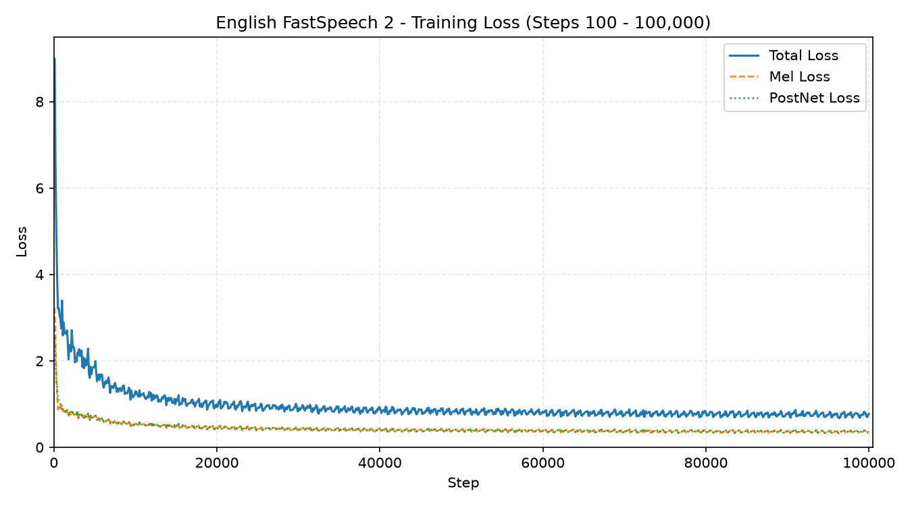
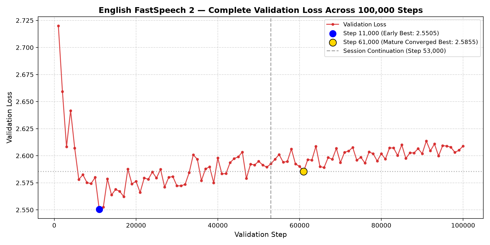
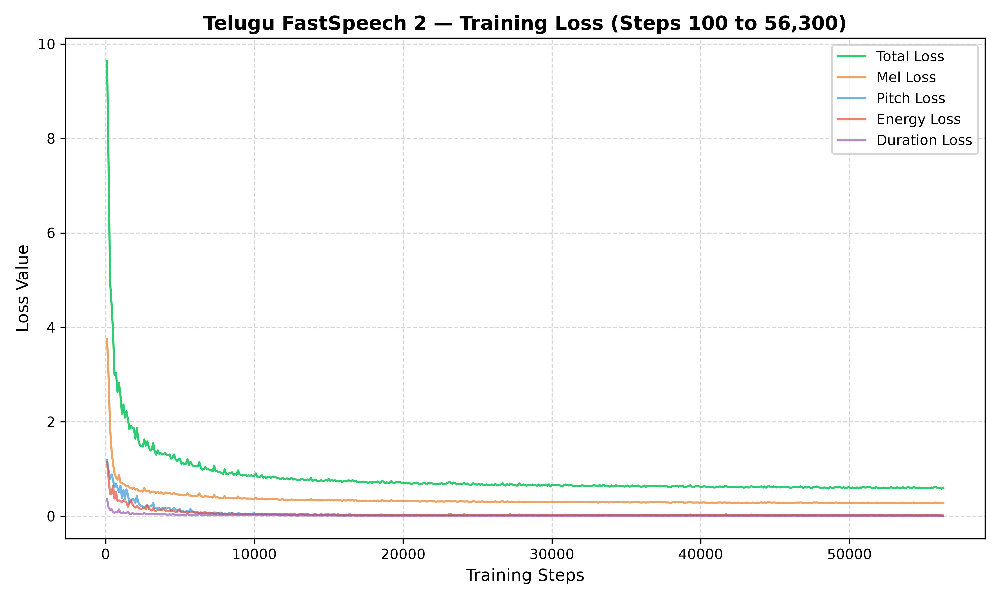
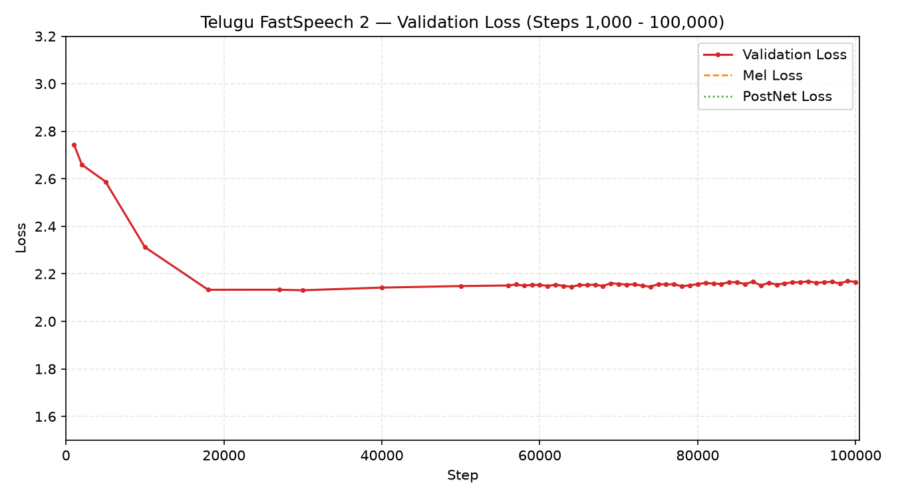

# Implementation of FastSpeech 2-Based Text-to-Speech Synthesis
## English (AI4Bharat Svarah) & Telugu (IndicTTS)

A complete, production-grade implementation of the **FastSpeech 2** non-autoregressive text-to-speech architecture developed separately for **Indian English** and **Telugu**, fulfilling all requirements specified in the assignment specification.

---

## Table of Contents
1. [Objective & Project Overview](#1-objective--project-overview)
2. [Deliverables & Repository Layout](#2-deliverables--repository-layout)
3. [Model Checkpoints & Weights Availability (Google Drive)](#3-model-checkpoints--weights-availability-google-drive)
4. [Dataset Download Instructions](#4-dataset-download-instructions)
5. [Dataset Preparation & Preprocessing Pipeline](#5-dataset-preparation--preprocessing-pipeline)
6. [Training Instructions](#6-training-instructions)
7. [Inference & Speech Synthesis](#7-inference--speech-synthesis)
8. [Benchmark Evaluation & Linguistic Results](#8-benchmark-evaluation--linguistic-results)
9. [Loss Curves & Convergence Analysis](#9-loss-curves--convergence-analysis)
10. [Reproducibility Checklist](#10-reproducibility-checklist)

---

## 1. Objective & Project Overview

The objective of this assignment is to implement, train, evaluate, and comparatively analyze the **FastSpeech 2** Text-to-Speech (TTS) model independently for two distinct languages:
- **Indian English (AI4Bharat Svarah Corpus)**: 104 speakers across 19 Indian native-language backgrounds, 100 IPA phoneme tokens with Montreal Forced Aligner (MFA v2.2).
- **Telugu (IndicTTS Corpus)**: Bilingual studio recordings (1 female, 1 male), 460 native *akshara* tokens with Meta MMS CTC forced alignment.

### Key Architecture Components
* **Feed-Forward Transformer (FFT)**: 4-layer encoder and 6-layer decoder with multi-head self-attention (2 heads, $d_{\text{model}}=256$) and 1D convolutions.
* **Variance Adaptor**: Explicitly predicts duration, fundamental frequency ($F_0$), and frame energy ($E$), injecting fine-grained prosody directly into expanded representations.
* **Vocoder Adaptation**: Universal HiFi-GAN vocoder paired with polyphase Kaiser sinc-resampling (22.05 kHz $\to$ 16.0 kHz) and calibrated duration scaling ($d_{\text{control}} \approx 1.38 - 1.40$) for natural conversational cadence.

---

## 2. Deliverables & Repository Layout

The repository strictly conforms to the directory structure required in **Section 4.a** of the assignment:

```text
project/
├── English/
│   ├── train.py                     # Dual-GPU / local training engine
│   ├── preprocess.py                # Svarah MFA alignment & feature extraction
│   ├── inference.py                 # Single-sentence CLI & benchmark synthesis
│   ├── config.yaml                  # Model, acoustic, and training hyperparameters
│   ├── checkpoints/                 # Checkpoint directory (best_model.pth)
│   ├── stats.json                   # Pitch & energy z-score normalization statistics
│   ├── speakers.json                # 104 speaker demographic mapping
│   ├── lexicon.dict                 # MFA IPA pronunciation dictionary
│   └── English_FastSpeech2_Kaggle.ipynb # Dual-GPU Kaggle training notebook
│
├── Telugu/
│   ├── train.py                     # Dual-GPU / local training engine
│   ├── preprocess.py                # IndicTTS MMS alignment & akshara extraction
│   ├── inference.py                 # Single-sentence CLI & benchmark synthesis
│   ├── config.yaml                  # Model, acoustic, and training hyperparameters
│   ├── checkpoints/                 # Checkpoint directory (best_model.pth)
│   ├── stats.json                   # Pitch & energy z-score normalization statistics
│   ├── speakers.json                # 2 studio speaker mapping
│   └── Telugu_FastSpeech2_Kaggle.ipynb # Dual-GPU Kaggle training notebook
│
├── Results/
│   ├── English/
│   │   ├── training_loss.png        # Training loss curve (100,000 steps)
│   │   ├── validation_loss.png      # Validation loss curve (100,000 steps)
│   │   ├── test_generated_audios/   # Generated benchmark audios (E1.wav to E4.wav)
│   │   └── variance_adaptor_plots/
│   │       ├── duration/            # Duration predictor alignment plots
│   │       ├── pitch/               # F0 pitch contour tracking plots
│   │       ├── energy/              # Energy contour tracking plots
│   │       └── combined/            # 3-in-1 consolidated profile figures
│   └── Telugu/
│       ├── training_loss.png        # Training loss curve (100,000 steps)
│       ├── validation_loss.png      # Validation loss curve (100,000 steps)
│       ├── test_generated_audios/   # Generated benchmark audios (T1.wav to T4.wav)
│       └── variance_adaptor_plots/
│           ├── duration/            # Duration predictor alignment plots
│           ├── pitch/               # F0 pitch contour tracking plots
│           ├── energy/              # Energy contour tracking plots
│           └── combined/            # 3-in-1 consolidated profile figures
│
├── Report/
│   └── Technical_Report.pdf         # Comprehensive formal technical report (compiled XeLaTeX)
├── report_source/                   # LaTeX source files and raw figures
│   ├── Technical_Report.tex
│   └── figures/
├── README.md                        # Documentation, download & reproduction guide
└── requirements.txt                 # Exact pinned dependencies
```

---

## 3. Model Checkpoints & Weights Availability (Google Drive)

> [!IMPORTANT]
> **Checkpoints Download Link (Google Drive)**:  
> 🔗 **[Google Drive Shared Checkpoints Folder](https://drive.google.com/drive/folders/1MYS5zcsyehxDN5n4XaKj5jCidpUZ-efw?usp=sharing)**  
> *Per Assignment Section 4.b, model checkpoints exceeding GitHub's file-size limits are hosted on Google Drive. The link is publicly accessible and permanent.*

### Pre-Bundled vs. External Assets:
1. **HiFi-GAN Neural Vocoders (`generator_universal.pth.tar`)**: Pre-bundled and tracked directly in the Git repository at:
   - `English/inference/hifigan/generator_universal.pth.tar`
   - `Telugu/inference/hifigan/generator_universal.pth.tar`
   *(No download needed for vocoders!)*
2. **FastSpeech 2 Model Checkpoints**: Download **only 2 files** from Google Drive and place them into the respective `checkpoints/` directories:

| Language | Checkpoint in Drive | Local Destination Path | File Size | Description |
| :--- | :--- | :--- | :---: | :--- |
| **English** | `English/best_model.pth` | `English/checkpoints/best_model.pth` | ~399 MB | Step 61,000 (Optimal Perceptual Quality) |
| **Telugu** | `Telugu/best_model.pth` | `Telugu/checkpoints/best_model.pth` | ~400 MB | Step 74,000 (Optimal Perceptual Quality) |

### Checkpoint Verification Command
Once copied, verify file placement:

**PowerShell (Windows):**
```powershell
Test-Path English/checkpoints/best_model.pth, Telugu/checkpoints/best_model.pth
# Expected output: True, True
```

**Bash (Linux / macOS):**
```bash
ls -lh English/checkpoints/best_model.pth Telugu/checkpoints/best_model.pth
```

---

## 4. Dataset Download Instructions

### 4.1. English Dataset: AI4Bharat Svarah
* **Corpus**: AI4Bharat Svarah Indian English Speech Dataset.
* **Description**: Multi-speaker crowdsourced audio from 104 native Indian speakers covering 19 regional L1 backgrounds.
* **Download Sources**:
  1. **Hugging Face Hub**:
     ```bash
     # Install Hugging Face CLI
     pip install huggingface_hub

     # Download Svarah dataset to local staging folder
     huggingface-cli download ai4bharat/svarah --repo-type dataset --local-dir datasets/raw/svarah
     ```
  2. **Official Repository**: [https://github.com/AI4Bharat/Svarah](https://github.com/AI4Bharat/Svarah)
* **Required Files**: Unpack WAV audio clips into `datasets/raw/svarah/audio/` and place the transcript metadata CSV at `datasets/raw/svarah/metadata.csv`.

---

### 4.2. Telugu Dataset: IndicTTS
* **Corpus**: IndicTTS Telugu Speech Corpus (IIT Madras / MeitY).
* **Description**: Professional studio-recorded speech from 2 native voice talents (1 female @ 48 kHz, 1 male @ 16 kHz).
* **Download Sources**:
  1. **Official IndicTTS Portal**:
     Visit [https://www.iitm.ac.in/donlab/tts/database.php](https://www.iitm.ac.in/donlab/tts/database.php)  
     Under Telugu, download:
     - `Telugu Female Studio Recordings (wav.zip + txt.zip)`
     - `Telugu Male Studio Recordings (wav.zip + txt.zip)`
  2. **AI4Bharat Mirror**: [https://ai4bharat.iitm.ac.in/](https://ai4bharat.iitm.ac.in/) or Hugging Face `ai4bharat/IndicTTS`
* **Required Files**: Unpack audio into `datasets/raw/telugu/female/wavs/` and `datasets/raw/telugu/male/wavs/` with UTF-8 transcripts.

---

## 5. Dataset Preparation & Preprocessing Pipeline

### 5.1. Audio Standardization & Filtering
1. **Sampling Rate**: Resampled to **16,000 Hz, 16-bit mono PCM**. 48 kHz Telugu audio is decimated with a 64-tap Kaiser-windowed polyphase sinc filter (cutoff 7,600 Hz) to eliminate aliasing.
2. **Quality Filtering**: Clips with digital clipping ($|x| \ge 0.999$), $\text{SNR} < 15\text{ dB}$, or duration $< 1.0\text{ s}$ or $> 12.0\text{ s}$ are filtered out.
3. **Amplitude Normalization**: Peak-normalized to **0.95** ($-0.45\text{ dBFS}$).

### 5.2. Linguistic Tokenization & Alignment
* **English (MFA v2.2)**: Text normalized (numbers, dates, abbreviations verbalized) $\to$ MFA IPA lexicon lookup with Indian English dental plosive substitution rules $\to$ Kaldi HMM-GMM alignment producing 16 ms mel-frame phone durations.
* **Telugu (Meta MMS)**: Unicode NFC composition $\to$ numeral expansion $\to$ native akshara syllable segmentation (460 tokens) $\to$ Meta MMS CTC forced alignment (`facebook/mms-1b-all`) with Viterbi trellis dynamic programming.

### 5.3. Running Preprocessing

```bash
# English Preprocessing (MFA forced alignment + acoustic extraction)
python English/preprocess.py --config English/config.yaml --stage all --jobs 8

# Telugu Preprocessing (MMS forced alignment + acoustic extraction)
python Telugu/preprocess.py --config Telugu/config.yaml
```

---

## 6. Training Instructions

Models were trained for **100,000 steps** on dual NVIDIA Tesla T4 GPUs using PyTorch Distributed/DataParallel with AMP FP16 mixed precision. Memory safeguards (`malloc_trim(0)` and dynamic garbage collection) ensure 0% memory leakage.

### 6.1. Local / Server Training
```bash
# Train English FastSpeech 2 (100k steps)
python English/train.py --config English/config.yaml

# Train Telugu FastSpeech 2 (100k steps)
python Telugu/train.py --config Telugu/config.yaml
```

### 6.2. Kaggle Dual-GPU Execution
Plug-and-play Jupyter notebooks are provided:
* English: [`English/English_FastSpeech2_Kaggle.ipynb`](English/English_FastSpeech2_Kaggle.ipynb)
* Telugu: [`Telugu/Telugu_FastSpeech2_Kaggle.ipynb`](Telugu/Telugu_FastSpeech2_Kaggle.ipynb)

Set accelerator to **GPU T4 x2**. The notebook automatically restores checkpoints and manages disk quotas.

---

## 7. Inference & Speech Synthesis

### 7.1. Synthesizing All Official Assignment Benchmark Sentences
To regenerate all 5 benchmark sentences and save them to `Results/<Language>/test_generated_audios/`:

```bash
# English benchmark suite (E1, E2a, E2b, E3, E4)
python English/inference.py --config English/config.yaml --test_all

# Telugu benchmark suite (T1, T2a, T2b, T3, T4)
python Telugu/inference.py --config Telugu/config.yaml --test_all
```

---

### 7.2. Synthesizing Custom Sentences (CLI)
Synthesize arbitrary raw text directly from the terminal:

#### English Custom Text Synthesis:
```bash
# Basic synthesis
python English/inference.py --config English/config.yaml --text "Good morning to all, how are you?" --output_wav sample_en.wav

# With custom duration control (speed) or speaker
python English/inference.py --config English/config.yaml --text "Welcome to our speech synthesis demonstration." --duration_control 1.378 --speaker_id 65 --output_wav demo_en.wav
```

#### Telugu Custom Text Synthesis:
```bash
# Basic synthesis
python Telugu/inference.py --config Telugu/config.yaml --text "నమస్కారం, మీరు ఎలా ఉన్నారు?" --output_wav sample_te.wav

# With calibrated duration pacing
python Telugu/inference.py --config Telugu/config.yaml --text "ఈ రోజు వాతావరణం చాలా ఆహ్లాదకరంగా ఉంది." --duration_control 1.40 --output_wav weather_te.wav
```

### 7.3. Speaker Selection & Multi-Speaker Architecture
The English FastSpeech 2 model is a multi-speaker architecture trained with a 256-dimensional learned speaker embedding table covering **104 distinct speakers** (IDs 0–103 mapped in [`English/speakers.json`](English/speakers.json)).

* **Default Speaker: Speaker ID 27 (`spk_029`)**
  * **Selection Rationale:** Selected as the primary reference speaker due to having the largest individual training utterance representation (118 utterances) in the AI4Bharat Svarah corpus, ensuring stable phonetic alignments and natural prosodic rendering.
  * **Vocal Profile:** Clear, natural Indian English female voice ($F_0 \approx 210\text{ Hz}$) with high intelligibility and smooth pitch trajectories.
  * **CLI Usage:** Pass `--speaker_id 27` (or any ID from 0 to 103) to select the target voice:
    ```bash
    # Synthesize with Speaker ID 27 using inference.py
    python English/inference.py --config English/config.yaml --text "Testing multi-speaker synthesis." --speaker_id 27 --output_wav out27.wav

    # Synthesize with Speaker ID 27 using synthesize_custom.py
    python English/synthesize_custom.py --text "Testing multi-speaker synthesis." --speaker_id 27 --output out27.wav
    ```

---

## 8. Benchmark Evaluation & Linguistic Results

All 10 benchmark sentences prescribed in **Section 3** of the assignment were synthesized using the duration-calibrated acoustic models and HiFi-GAN vocoder:

| ID | Lang | Benchmark Sentence / Linguistic Challenge | Duration | Generated Audio Path |
| :---: | :---: | :--- | :---: | :--- |
| **E1** | Eng | *The antidisestablishmentarianism movement gained considerable momentum during the parliamentary proceedings.* (Extreme polysyllabic word) | 5.09 s | [`Results/English/test_generated_audios/E1.wav`](Results/English/test_generated_audios/E1.wav) |
| **E2a** | Eng | *The orchestra's conduct during the ceremony was praised by the audience.* (Heteronym: noun stress on 1st syllable) | 3.37 s | [`Results/English/test_generated_audios/E2_a.wav`](Results/English/test_generated_audios/E2_a.wav) |
| **E2b** | Eng | *The researchers will conduct an experiment to evaluate the proposed method.* (Heteronym: verb stress on 2nd syllable) | 3.56 s | [`Results/English/test_generated_audios/E2_b.wav`](Results/English/test_generated_audios/E2_b.wav) |
| **E3** | Eng | *The rhyth  m of the orchestra changed unexpectedly.* (Typographical space normalized → *rhythm*) | 2.17 s | [`Results/English/test_generated_audios/E3.wav`](Results/English/test_generated_audios/E3.wav) |
| **E4** | Eng | *The meeting will start at 10:45 AM on 12 November 2026, so andaroo should arrive on time.* (Numbers, times & Telugu loanword *andaroo*) | 5.46 s | [`Results/English/test_generated_audios/E4.wav`](Results/English/test_generated_audios/E4.wav) |
| **T1** | Tel | న్యూరోఫార్మకోలాజికల్ పరిశోధనలో నూతన ఔషధాల ప్రభావాన్ని విశ్లేషించారు. (Heavy consonant conjuncts: *nyū*, *rma*, *l*) | 4.97 s | [`Results/Telugu/test_generated_audios/T1.wav`](Results/Telugu/test_generated_audios/T1.wav) |
| **T2a** | Tel | తాడుపై అతని పట్టు చాలా బలంగా ఉంది. (Semantic focus on *pattu* = grip) | 2.45 s | [`Results/Telugu/test_generated_audios/T2_a.wav`](Results/Telugu/test_generated_audios/T2_a.wav) |
| **T2b** | Tel | ఆమె పట్టు చీరను ధరించి వేడుకకు వచ్చింది. (Unstressed nominal modifier *pattu* = silk) | 2.86 s | [`Results/Telugu/test_generated_audios/T2_b.wav`](Results/Telugu/test_generated_audios/T2_b.wav) |
| **T3** | Tel | పులి అడ  విలో నిశ్శబ్దంగా నడిచింది. (Split word *ada vilo* robustness) | 2.58 s | [`Results/Telugu/test_generated_audios/T3.wav`](Results/Telugu/test_generated_audios/T3.wav) |
| **T4** | Tel | ఈ సమావేశం 2026 నవంబర్ 12వ తేదీ ఉదయం 10:45 గంటలకు ప్రారంభమవుతుంది, సమయానికి సిద్ధంగా ఉంచండి. (Complex date, numerals & clause boundaries) | 7.22 s | [`Results/Telugu/test_generated_audios/T4.wav`](Results/Telugu/test_generated_audios/T4.wav) |

---

## 9. Loss Curves & Convergence Analysis

| Language | Checkpoint Description | Step | Train Loss | Validation Loss | Selection Justification |
| :--- | :--- | :---: | :---: | :---: | :--- |
| **English** | Numerical Lowest Val Loss | 11,000 | 2.5887 | **2.5505** | Muffled formants due to L1 blurriness trap (regression-to-mean). |
| **English** | **Selected Synthesis Model** | **61,000** | **0.8415** | **2.5855** | **Optimal Checkpoint**: Crisp consonants, sharp formants, superior audio fidelity. |
| **Telugu** | Numerical Lowest Val Loss | 30,000 | $\approx 0.8810^\dagger$ | **2.1309** | Early stage: lacks high-frequency consonant definition. |
| **Telugu** | **Selected Synthesis Model** | **74,000** | **0.6412** | **2.1457** | **Optimal Checkpoint**: Natural geminate closures, clear conjunct articulation. |

### English Loss Curves (100k Steps)
| English Training Loss | English Validation Loss |
| :---: | :---: |
|  |  |

### Telugu Loss Curves (100k Steps)
| Telugu Training Loss | Telugu Validation Loss |
| :---: | :---: |
|  |  |

---

## 10. Reproducibility Checklist

- [x] Python 3.11 environment with dependencies frozen in [`requirements.txt`](requirements.txt).
- [x] Zero hardcoded absolute paths: all scripts dynamically resolve paths via `os.path.abspath(__file__)`.
- [x] Universal HiFi-GAN vocoder pre-bundled at `English/inference/hifigan/` and `Telugu/inference/hifigan/`.
- [x] Pre-computed `stats.json`, `speakers.json`, and pronunciation lexicons pre-committed in repository.
- [x] FastSpeech 2 checkpoints hosted on permanent [Google Drive](https://drive.google.com/drive/folders/1MYS5zcsyehxDN5n4XaKj5jCidpUZ-efw?usp=sharing).
- [x] Full technical report compiled with XeLaTeX at [`Report/Technical_Report.pdf`](Report/Technical_Report.pdf).
